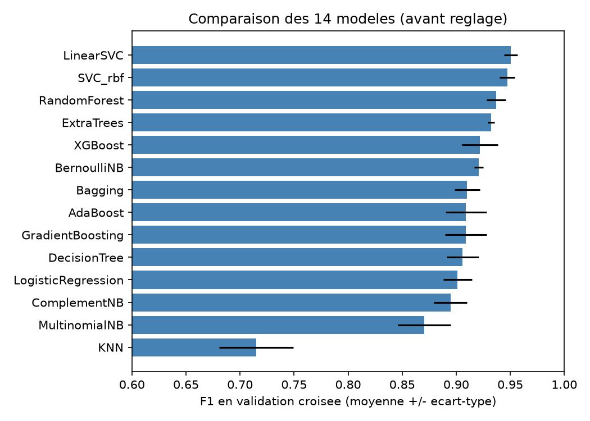
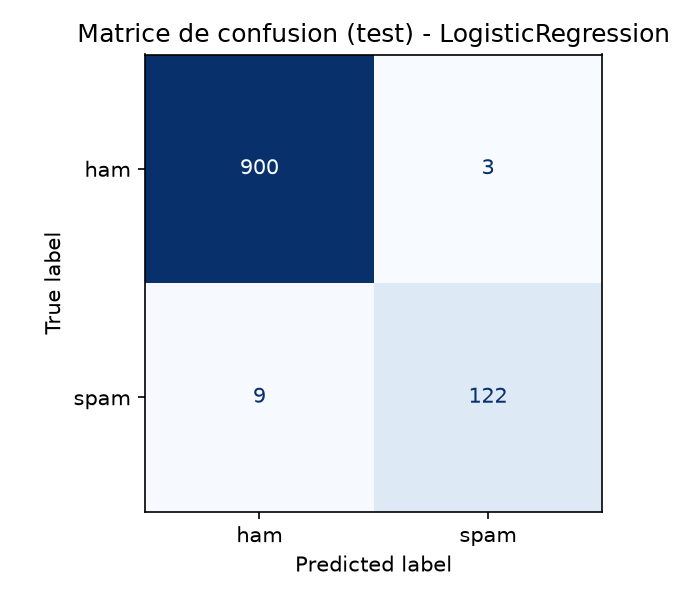
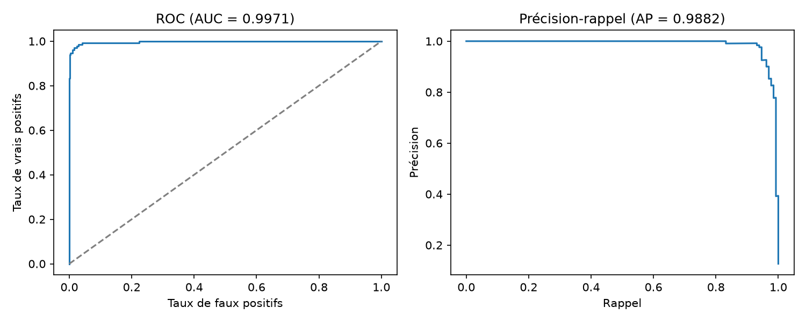
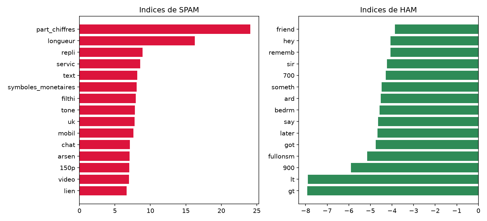

# 📩 Détection de SMS / emails indésirables (Spam)

Projet académique de groupe en Machine Learning : détecter et classifier les messages indésirables (spam) à l'aide de plusieurs algorithmes d'apprentissage automatique, avec une application web Streamlit.


## Équipe

| Nom | GitHub |
|---|---|
| AGBEVO Kodjo Honoré | [@Honore-M12](https://github.com/Honore-M12) |
| BIHAHO Kossi | [@kossibihaho](https://github.com/kossibihaho) |
| IRERA Furaha Jospine | [@jospine463](https://github.com/jospine463/) |
| RAKOTOMANGA Manohisoa Mireille | [@soamanohy](https://github.com/soamanohy) |

**Encadrant :** Prof. Mr [Ayoub Charef](https://www.linkedin.com/in/ayoub-charef-531897128/)

## Résultats en bref

Modèle final : **régression logistique** (TF-IDF 3 000 mots + 5 caractéristiques, `class_weight="balanced"`, C = 30), évalué sur **1 034 messages jamais vus** à l'entraînement.

| Précision | Rappel | F1 | AUC ROC | Faux positifs | Faux négatifs |
|---|---|---|---|---|---|
| 0,976 | 0,931 | 0,953 | 0,997 | 3 | 9 |

> Les chiffres exacts sont dans `reports/metrics.json` (régénérés à chaque entraînement).

## Données

[SMS Spam Collection](https://archive.ics.uci.edu/dataset/228/sms+spam+collection) : 5 572 SMS **en anglais**, 5 169 après suppression de 403 doublons. Classes déséquilibrées : 4 516 hams (87,4 %) et 653 spams (12,6 %). Le fichier source contient un défaut d'encodage (`å£` au lieu de `£`), corrigé au chargement.

## Méthodologie

1. **Nettoyage** : colonnes vides retirées, doublons supprimés, symbole `£` réparé.
2. **Prétraitement** : minuscules, tokens alphanumériques, suppression des stopwords, stemming de Porter.
3. **Variables** : TF-IDF + 5 caractéristiques (longueur plafonnée à 160 caractères, part de chiffres, part de majuscules, symboles monétaires, présence d'un lien).
4. **Évaluation** : split stratifié 80/20 ; validation croisée à 5 plis sur le train uniquement ; test utilisé une seule fois. Métriques : précision, rappel, F1, AUC, faux positifs/négatifs.
5. **Comparaison** de 14 modèles, expériences contrôlées, puis réglage par `GridSearchCV` des 3 meilleures familles.

### Benchmark (validation croisée, F1)

| Modèle | CV F1 | Test précision | Test rappel |
|---|---|---|---|
| LinearSVC | 0,954 | 0,992 | 0,901 |
| SVC rbf | 0,951 | 0,992 | 0,908 |
| RandomForest | 0,936 | 0,983 | 0,886 |
| ExtraTrees | 0,934 | 0,983 | 0,893 |
| BernoulliNB | 0,920 | 0,983 | 0,901 |

Les 14 modèles sont dans `reports/benchmark.csv`.

### Ce que les expériences ont montré

- Les **caractéristiques supplémentaires** sont le seul gain solide : LinearSVC passe de 0,913 à 0,954 de F1 et la régression logistique de 0,899 à 0,948.
- Le nombre de mots (`max_features`) et les n-grammes n'ont **pas d'effet significatif** sur les modèles linéaires.
- Après réglage, **LinearSVC, régression logistique et BernoulliNB sont à égalité statistique** (CV F1 de 0,955 à 0,962, écart-type de 0,006 à 0,010). La régression logistique a été retenue car elle fournit des scores directement exploitables et des coefficients interprétables.






### Corrections apportées au notebook initial

Le notebook d'origine est conservé dans `notebooks/01_notebook_initial.ipynb`. Ses chiffres (par exemple 98,4 % d'accuracy) **ne sont pas comparables** à ceux ci-dessus : le protocole a changé.

| Problème du notebook initial | Correction |
|---|---|
| TF-IDF et scaler ajustés sur tout le jeu de données (fuite de données) | `Pipeline` scikit-learn : tout est ajusté sur le train uniquement |
| Un seul split, sélection sur la précision seule | Validation croisée, F1 / rappel / AUC, test utilisé une seule fois |
| Section « amélioration » sans ré-entraînement (colonnes identiques) | Vraies expériences contrôlées (`src/experiments.py`) |
| Modèle sauvegardé non entraîné, scaler non sauvegardé | Pipeline complet sauvegardé et testé |
| Chemin Windows en dur, pas de `requirements`, README vide | Chemins relatifs, dépendances figées, tests automatiques |
| Artefact d'encodage `å£` | Corrigé au chargement |
| Longueur non plafonnée : un email légitime long était classé spam | Plafond à 160 caractères + test de non-régression |

## Limites

- **Anglais uniquement** : les messages en français ne sont pas fiables (l'application affiche un avertissement).
- **SMS, pas emails** : le modèle n'a vu aucun vrai email. Il se comporte raisonnablement sur des emails courts à moyens, mais n'a **pas été validé** sur un corpus d'emails. Les emails parlant d'argent (factures) restent à risque de faux positif.
- **Jeu de données ancien** : les spams actuels (phishing, livraisons, cryptomonnaies) y sont peu représentés.
- **Artefact appris** : `gt` et `lt` (restes d'entités HTML dans des SMS légitimes) sont des indices « ham » : le modèle a appris un défaut du jeu de données.
- Le modèle déployé est ré-entraîné sur toutes les données : il n'a plus de jeu de test indépendant. Les métriques annoncées viennent du modèle entraîné sur le train seul.

## Structure du dépôt

```
├── app/streamlit_app.py     # application Streamlit
├── data/spam.csv            # données brutes
├── models/spam_model.joblib # modèle de déploiement
├── notebooks/               # notebook initial (conservé)
├── reports/                 # métriques, tableaux CSV, figures
├── src/                     # code : données, prétraitement, pipeline, modèles, benchmark, réglage
├── tests/                   # tests pytest
├── run_all.sh               # régénère tout et lance les tests
├── requirements.txt         # dépendances de l'application
└── requirements-dev.txt     # dépendances d'entraînement et de test
```

## Installation (Git Bash)

```bash
git clone https://github.com/kossibihaho/Sms_email_spam_detection.git
cd Sms_email_spam_detection
python -m venv .venv
source .venv/Scripts/activate        # Linux / macOS : source .venv/bin/activate
pip install -r requirements-dev.txt
```

## Utilisation

```bash
# Lancer l'application (le modèle est déjà fourni)
streamlit run app/streamlit_app.py

# Tout régénérer : benchmark, expériences, réglage, modèle final, tests
bash run_all.sh

# Ou étape par étape
python -m src.benchmark
python -m src.experiments
python -m src.tune
python -m src.train_final
```

## Tests

```bash
python -m pytest -q
```

Les tests couvrent le chargement des données, le prétraitement, les caractéristiques (dont le plafond de longueur), l'absence de fuite de données, le modèle sauvegardé (dont un test de non-régression sur un email long légitime), les métriques minimales et le chargement de chaque page de l'application.

## Source des données

Almeida, T. A., Gómez Hidalgo, J. M., Yamakami, A. (2011). *Contributions to the study of SMS spam filtering.* UCI Machine Learning Repository.
